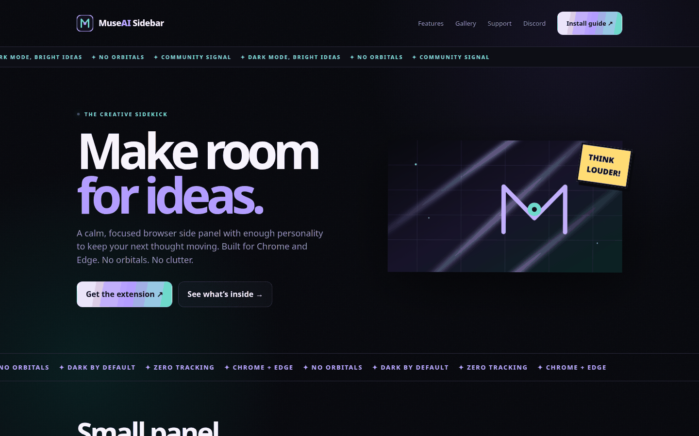
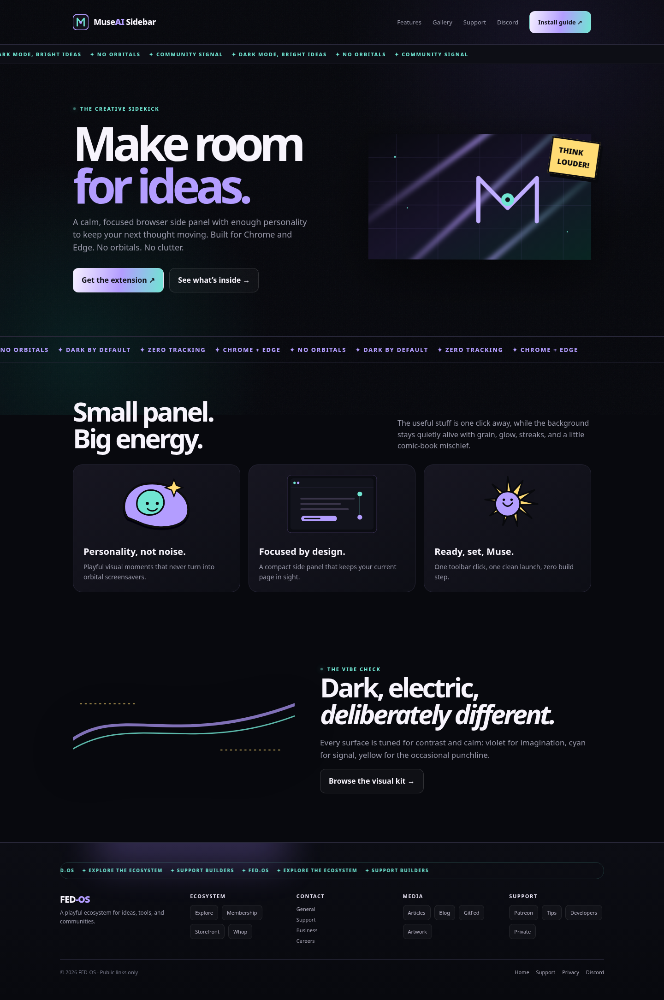
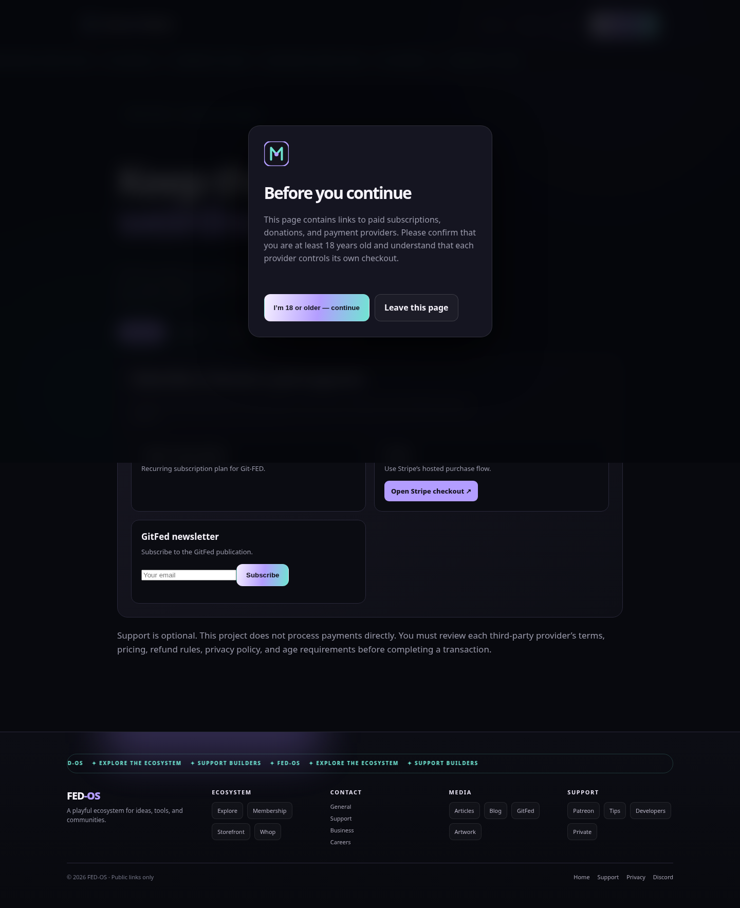
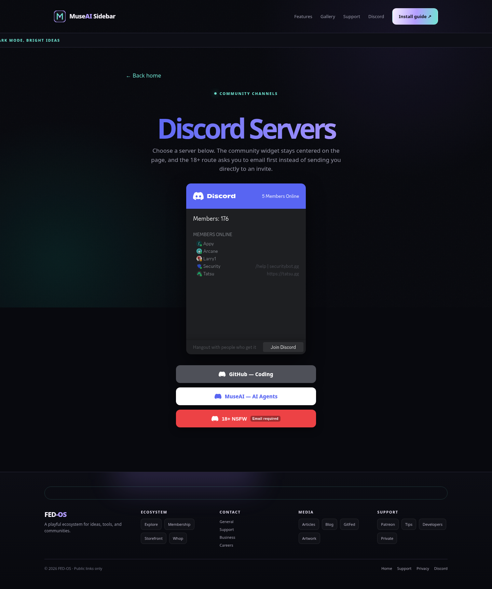

# Muse AI Sidebar

A dark, animated Manifest V3 side-panel extension for Chrome and Microsoft Edge that gives you a focused route to Muse AI without leaving the page you are working on.

[](LICENSE) [](docs/INSTALL.md) [](docs/INSTALL.md) [](manifest.json)

## Why this exists

Opening a creative tool usually means leaving the page, opening another tab, and losing the context that made the idea useful in the first place. This project gives Chrome and Edge users a compact side-panel shell that stays visually calm, but never feels lifeless.

It is intentionally small: no backend, no build pipeline, no remote code, no analytics, and no data collection. The extension action opens the local panel; the panel’s primary action opens Muse AI in a new tab, avoiding fragile cross-origin iframe and authentication behavior.

## See it work

The fastest way to preview the visual experience is the static Pages site. It is the actual HTML/CSS/JS implementation in this repository, not a mockup.

**[Open the local site entry point](site/index.html)** · **[Read the install guide](site/pages/install.html)** · **[Browse the asset gallery](site/pages/gallery.html)**



The demo GIF captures the real homepage as its animated background, scrolling marquee, hover effects, and page sections render. The site also includes an age-gated support page and a dedicated Discord page with a centered widget.

## Screenshots

### Main landing page



### Age-gated support page



### Community page



## Quick start

### Preview the static site locally

```bash
# from the repository root
python3 -m http.server 8080 --directory site
```

Open [http://localhost:8080](http://localhost:8080). The homepage is `site/index.html`; internal destinations are real HTML pages under `site/pages/`.

### Try the browser extension

1. Download or clone this repository.
2. Open `chrome://extensions` in Chrome or `edge://extensions` in Edge.
3. Enable **Developer mode**.
4. Select **Load unpacked**.
5. Choose the repository root, `MuseAi-Sidebar-Extension/`.
6. Pin **Muse AI Sidebar**, then click its toolbar icon.
7. Click **Open Muse AI** in the side panel.

The browser-specific checklist is in [`docs/INSTALL.md`](docs/INSTALL.md).

### Test the JavaScript files

There is no package manager or build step. If Node.js is available, run the lightweight syntax checks:

```bash
node --check background.js
node --check sidebar/sidebar.js
node --check site/site.js
```

## What is included

- **Browser extension:** `manifest.json`, `background.js`, and the `sidebar/` HTML/CSS/JS shell.
- **Static site:** `site/index.html`, animated `site/site.css`, `site/site.js`, and dedicated HTML pages for features, installation, privacy, gallery, support, Discord servers, and private communities.
- **Visual kit:** symbol-only favicon, logo variants, hero banner, comic illustrations, motion artwork, store assets, and looping GIFs under `site/assets/`.
- **Real README media:** screenshots and an animated demo captured from the working static site under `assets/demo/`.
- **Store materials:** Chrome Web Store and Edge Add-ons descriptions, screenshots, promo tiles, and icons.
- **Privacy and licensing:** [`PRIVACY.md`](PRIVACY.md) and [`LICENSE`](LICENSE).

## Deployment

The static marketing site is ready to deploy from the `site/` directory on GitHub Pages or Cloudflare Pages/Workers. No build command is required; use `site` as the publish directory.

This repository does **not** currently contain a GitHub Actions workflow, a `wrangler.toml`, or a published live-demo URL. Deployment is therefore ready by structure, but not claimed as already enabled or live.

Internal site navigation uses real `.html` destinations. Payment, support, Discord, and other third-party actions intentionally leave the site for the provider’s own page after the relevant gate or confirmation.

## Repository map

```text
MuseAi-Sidebar-Extension/
├── README.md
├── LICENSE
├── PRIVACY.md
├── .gitignore
├── manifest.json
├── background.js
├── sidebar/
│   ├── sidebar.html
│   ├── sidebar.js
│   └── sidebar.css
├── site/
│   ├── index.html
│   ├── site.css
│   ├── site.js
│   ├── assets/
│   │   ├── favicon.svg
│   │   ├── logo-symbol.svg
│   │   ├── hero-banner.svg
│   │   └── gifs/
│   └── pages/
│       ├── features.html
│       ├── install.html
│       ├── privacy.html
│       ├── gallery.html
│       ├── support.html
│       ├── discord.html
│       └── private-communities.html
├── assets/
│   └── demo/
│       ├── site-demo.gif
│       ├── homepage.png
│       ├── support-age-gate.png
│       └── discord-servers.png
├── icons/
├── store/
└── docs/
    └── INSTALL.md
```

## Design principles

- Dark, high-contrast visuals with violet, cyan, and yellow accents.
- Motion that adds feedback and personality without orbital graphics.
- Real HTML destinations instead of dead-end text or placeholder buttons.
- Reduced-motion fallbacks for people who prefer less animation.
- Third-party payment and private-community links kept behind clear gates.

## License

MIT. See [`LICENSE`](LICENSE).
